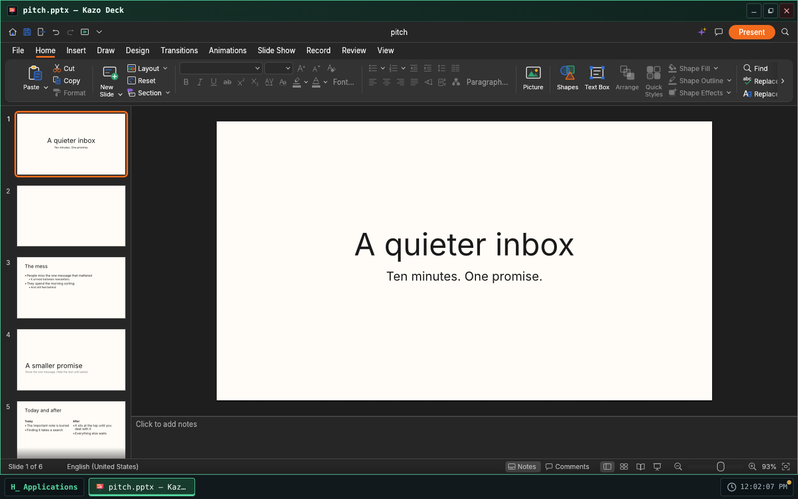
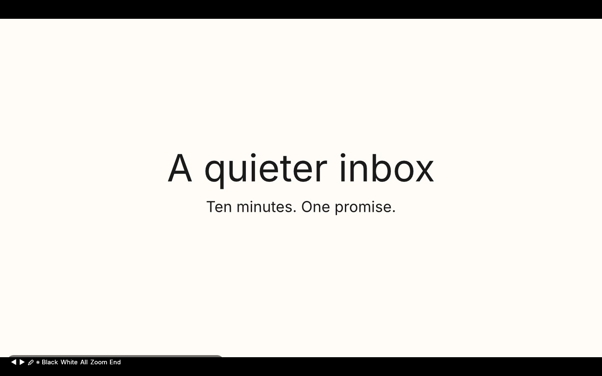
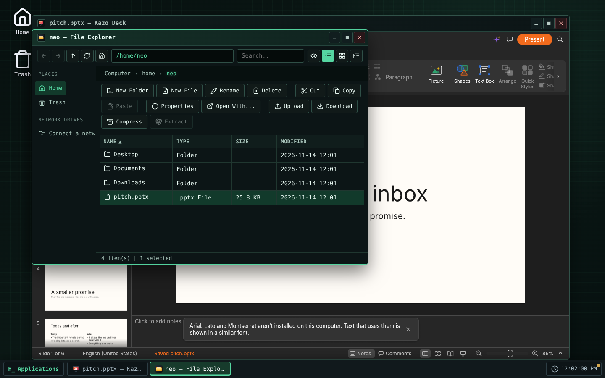

> [Version française](readme-fr.md)

<!-- Store listing: generated from store/ by .github/scripts/store-readme.mjs. Edit store/, then run it. -->


# Kazo Deck

A presentation editor for Kazo OS. Kazo Deck is based on
[DeckCraft](https://github.com/storytold/deckcraft) by the ArtCraft team, an open-source
presentation editor written in Rust, running here in a Kazo OS window.

## Make presentations

- Slide masters and layouts, themes with colour and font schemes, sections, comments, notes,
  headers and footers, any slide size.
- Over 150 shapes with adjust handles, connectors, freeform drawing, merge shapes, gradients,
  shadows, glow and reflections.
- Formatted text on the slide: fonts, paragraphs, bullets and numbering, columns, autofit, links.
- Pictures, tables, charts, icons, audio and video.
- Transitions (Morph included), entrance, emphasis and exit animations, and motion paths.
- Starter templates to begin a presentation in seconds.

## Present

- F5 starts the slide show from the beginning, Shift+F5 from the current slide, and so does the
  "Present" button: the presentation goes full screen in the browser. Esc, or the end of the last
  slide, brings you back to the window.
- If the browser refuses full screen, the slide show fills the window.

## Your Kazo OS files

- Double-click a `.pptx`, `.ppsx`, `.potx` or `.deckcraft` file in the File Explorer: it opens in
  Kazo Deck. `.txt`, `.md` and `.rtf` files offer it under "Open with" (an outline becomes slides).
- One presentation per window: opening another file, or Ctrl+N, opens a new window.
- Save writes back to the open file, in its format. Save As, and the first save of a new
  presentation, go through the Kazo OS save dialog.
- Export (PowerPoint, PDF, pictures, animated GIF, outline) goes through the Kazo OS "Save a copy"
  dialog: the presentation stays bound to its file. The pictures of every slide go to the folder
  chosen for the first one. Nothing ends up in the browser's downloads.
- Closing the window asks before losing changes.
- Kazo Deck follows the Kazo OS light or dark theme.

## Known limits

- **DeckCraft is in alpha.** Most presentations open and save well, but keep a copy of the ones
  that matter.
- DeckCraft's interface is in English.
- Kazo OS opens files up to 128 MiB.
- DeckCraft in the browser embeds two fonts only: Inter and BIZ UDPGothic (Japanese). A
  presentation written with another font (Calibri, Arial, Lato…) shows in Inter, and its layout may
  move a little; the file keeps its fonts. Chinese, Korean, Arabic, Hebrew or Thai text may show as
  boxes.
- The presenter view (notes and next slide on another screen) is off for now.
- The window stays on the screen it opened on: moving it to another screen would reload DeckCraft
  and lose the open presentation.
- DeckCraft draws with WebGPU or WebGL 2: a browser or computer with neither shows an error screen
  instead of the slides.
- The download is about 15 MB (about 40 MB once installed), and each window loads its own copy of
  DeckCraft.

## License

Kazo Deck is free software under the MIT license. DeckCraft is under the MIT or Apache-2.0 license;
its notices, the licenses of the material it carries and those of the fonts (SIL Open Font License
1.1) ship with the app (see `THIRD-PARTY-NOTICES.md` in the repository). The ArtCraft name and
logos are trademarks of the ArtCraft team and are not used by Kazo Deck.

## Screenshots

<p>
  
  
  
</p>

<!-- /Store listing -->

## Try it

[Open Kazo Deck in Kazo OS](https://os.kazo.ca/?autolaunch=ca.kazo.deck): the link starts Kazo OS, installs the app from the official Store and opens it.

Or open [Kazo OS](https://os.kazo.ca/) and install Kazo Deck from the **Kazo OS Store** (category Productivity), or in the Kazo OS Terminal, as an administrator: `sudo kazopkg install Kazo-ca/Os-App-Deck`.

## About Kazo OS

[Kazo OS](https://github.com/Kazo-ca/Os) is a simulated operating system that runs in the browser, written in C# with Blazor WebAssembly. It gives a complete environment to build and run applications: desktop and windows, a persistent file system, processes, a POSIX shell, a simulated network, the Kazo OS Store, and a public SDK (NuGet packages) to make apps such as this one. Try it at <https://os.kazo.ca/> (PWA, works offline).

## Development

- Plan: [plan](doc/en/plan.md) ([documentation index](doc/en/README.md)). DeckCraft's notices and the licenses in the package: [THIRD-PARTY-NOTICES.md](THIRD-PARTY-NOTICES.md).

| Folder | Content |
| --- | --- |
| `src/Kazo.Deck` | The app (window app, its `[AppManifest]` class generates `manifest.json`) |
| `src/Kazo.Deck.Os` | A host that runs the whole Kazo OS with the base apps and this app: the project to start |
| `tests/Kazo.Deck.Tests` | Tests of the app (xUnit) |
| `external/KazoOs` | The Kazo OS repository as a git submodule, on a release tag |
| `external/deckcraft` | DeckCraft's sources: our fork `Kazo-ca/deckcraft`, branch `kazo/v0.19.0` (upstream commit `930e1694` "Release: DeckCraft v0.19.0" of the `release` branch, unchanged) |
| `src/Kazo.Deck/wwwroot/deckcraft/` | The DeckCraft web build compiled from that submodule, with its provenance `deckcraft.json` (`tools/build-deckcraft.sh`, workflow **Build DeckCraft**) |
| `tests/e2e/` | Playwright runs in the Kazo OS host (`npm run test:e2e`) |
| `store/` | What the Kazo OS Store shows: icon (PNG 256×256), short descriptions, descriptions, screenshots, `store.json`; the top of this README is generated from it (`npm run store:readme`, checked in CI) |
| `tests/installed/` | The app as the Store installs it, in a published Kazo OS: `kazopkg install` (or the Store with `--store`), a `.pptx` exported, opened by double-click, saved and shown full screen, the Store screenshots (`npm run test:installed`) |
| `THIRD-PARTY-NOTICES.md` | DeckCraft and what it bundles; linked into the package with `LICENSE` (`wwwroot/legal/`, with the files DeckCraft's NOTICE refers to in `wwwroot/legal/deckcraft/`) |

### First steps

```bash
# A repository created from the GitHub template already has the submodule:
git clone --recurse-submodules <your repository>

# A folder made with "dotnet new kazoos-solution" adds it once:
git init
git submodule add --depth 1 https://github.com/Kazo-ca/Os.git external/KazoOs
git -C external/KazoOs checkout v<Kazo OS version>
```

Then open the `Kazo.Deck.slnx` in Visual Studio or Rider and start `Kazo.Deck.Os`, or run
`dotnet run --project src/Kazo.Deck.Os`.

### The Kazo OS version

`external/KazoOs/wasm2/KazoOs/build/Versions.props` is the Kazo OS version of this repository.
To move to another version, move the submodule to its tag and commit it:

```bash
git -C external/KazoOs fetch --depth 1 origin tag v2.2.0
git -C external/KazoOs checkout v2.2.0
git add external/KazoOs
```

Never edit the submodule: the OS is not modified from an app repository, and CI refuses a
submodule with local changes or off its tag.

### Two build profiles

| Profile | Kazo OS comes from | Use |
| --- | --- | --- |
| `Debug` | the projects of the submodule (`KazoOsUseSource=true`) | step into the SDK and the OS, breakpoints anywhere |
| `Release` | the `Kazo.Os.*` packages of nuget.org, at the submodule's version | CI, `dotnet publish`, the Kazo OS Store |

Force either one with `-p:KazoOsUseSource=true` or `false`.

### Publishing to the Kazo OS Store

1. Fill `store/` (icon, short descriptions, descriptions, category and tags in `store.json`).
2. Change `Version` in the app's `[AppManifest]` class and commit it to `main`, then tag it: run the
   **Tag a release** workflow (Actions tab, or the GitHub API for an agent), which tags the head of
   `main` with the manifest's version and starts the two publishing workflows; or push the tag
   yourself: `git tag v1.0.0 && git push --tags`.
3. The **Publish to the Kazo OS Store** workflow builds the app and makes the catalog folder
   `apps/<appId>_<version>/`. With a `HACK_STORE_TOKEN` secret (a token allowed to fork and open
   pull requests), it opens the pull request to `Kazo-ca/Os-AppMarketPlace` from your fork;
   without it, download the run's artifact and open the pull request yourself.
   In the Kazo-ca organisation, the Kazo OS automation app (organisation secrets
   `KAZO_AUTOMATION_APP_ID` and `KAZO_AUTOMATION_APP_KEY`) opens it from a branch of the catalog
   instead, to its `beta` branch for a version with a suffix (`1.2.1-beta.1`).

`HACK_STORE_TOKEN` is a GitHub personal access token of yours, not something Kazo OS gives you:

1. GitHub ▸ **Settings** ▸ **Developer settings** ▸ **Personal access tokens** ▸ **Tokens (classic)** ▸
   **Generate new token (classic)**, with a short expiration and the **`repo`** and **`workflow`**
   scopes (a fine-grained token cannot cover both your fork and the catalog's repository).
2. Copy it (shown once) into this repository: **Settings** ▸ **Secrets and variables** ▸ **Actions** ▸
   **New repository secret**, name `HACK_STORE_TOKEN` (or `gh secret set HACK_STORE_TOKEN`).

`repo` reaches all your repositories: keep the token only in this secret and revoke it if in doubt.

The catalog never takes a binary from you: once your pull request is reviewed and merged, its CI
compiles the app at the tagged commit.

### Following new Kazo OS versions

The **Kazo OS SDK update** workflow (`sdk-update.yml`) runs every hour, when Kazo OS announces a
release, or by hand from the Actions tab. When Kazo OS has a newer version, it moves the submodule
to it, raises the app's version (`.github/scripts/bump-app-version.sh`) on a `kazoos-sdk/<version>`
branch and runs the CI there:

- a Kazo OS pre-release: the `beta` branch takes it, as version `x.y.(z+1)-beta.<n>`, which goes to
  the beta channel of the Kazo OS Store;
- a minor or major stable release: a pull request to `main`, merged, tagged and published;
- a patch stable release: checked only, nothing is published.

A red CI opens a `TODO` issue and changes nothing. A version with a suffix (`1.2.1-beta.1`) is
always published from `beta`, one without from `main`. The workflows of this repository are short:
they call the shared workflows of [Kazo-ca/Os-AppTemplate](https://github.com/Kazo-ca/Os-AppTemplate)
(`@v1`), so they improve without a change here. Without the Kazo OS automation secrets, allow GitHub
Actions to create pull requests (**Settings** ▸ **Actions** ▸ **General**) for the update to open its
pull request.

### Publishing on the `kazoos-packages` branch

The same `v*` tag also runs **Publish the Kazo OS packages**: it packs the app and pushes it to the
`kazoos-packages` branch of this repository, keeping the versions already published. Kazo OS
users then install it with `kazopkg install <owner>/<repo>`, without the Kazo OS Store.

These packages are not signed: apps are signed only in the Kazo OS Store repository
(`Kazo-ca/Os-AppMarketPlace`), when it builds your app from the catalog (ADR 0219). Kazo OS checks
them by their SHA-256 and asks an administrator before installing from an untrusted source. Users
who want a signed package install your app from the Kazo OS Store.
